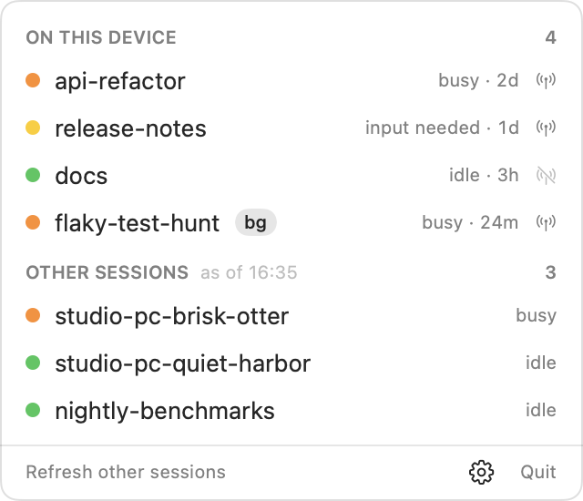

# SessionBar

A macOS menu bar app that lists your Claude Code sessions: the ones running on this Mac, and
the ones running on your other machines.

<picture>
  <source media="(prefers-color-scheme: dark)" srcset="docs/menu-dark.png">
  
</picture>

I run several sessions on two machines, they message each other by name, and it was slowly
becoming a mess. This is the list I wanted.

## What it shows

**On this device** is every live session on this Mac, updated every 3 seconds: its name, whether
it is busy, idle, in a shell or waiting (and for what), how long ago it started, and whether
Remote Control is on. A session with Remote Control off can be seen here and cannot be reached
from another machine.

**Other sessions** are the live sessions on your account that are not on this Mac. The list is
fetched when you open the menu and the last one is more than 10 minutes old, or when you press
Refresh. It is never polled, because each fetch costs a little usage (see below).

Click a row to copy the session's name, which is what other sessions address messages to. The
number in the menu bar is the total.

## Requirements

- macOS 14 or later. Built and used on macOS 26.
- Claude Code, signed in. Tested with 2.1.292; the older list format of 2.1.290 is read too.
- For the other sessions: Remote Control, on this Mac and on the sessions you want to see.
- The Xcode Command Line Tools to build it (`xcode-select --install`).

## Install

```sh
git clone https://github.com/runa-tic/session-bar.git
cd session-bar
./install.sh
```

That builds the app, puts it in `/Applications` (or `~/Applications` if that can't be written
to) and starts it. Run it again to update. There is no download to install instead: the app is
not notarized, and by default macOS refuses to open a downloaded app that is not.

If Other sessions says that Claude Code has to trust the helper folder, press **Trust it in
Terminal…**, accept the prompt Claude Code shows, type `/exit`, and press Refresh. This is
needed once. The folder is `~/Library/Application Support/SessionBar/helper`, it is empty, and
trusting it trusts nothing else.

**Open at login** is in the gear menu, and so is a switch to stop the menu from fetching the
other sessions when it opens.

## How it works

Sessions on this Mac come from Claude Code's own registry of live sessions, one small file per
session in `~/.claude/sessions/`. Reading them costs nothing.

The other machines are harder. Claude Code only hands the account-wide session list to a
session that is connected to Remote Control, and no command prints it. So for each fetch
SessionBar starts a short background session (`claude --bg`, on Haiku, with the `ListAgents`
tool and nothing else), lets a hook save what the tool returned, then stops the session, removes
it and deletes its transcript.

A fetch therefore takes a few seconds and one short model turn of your subscription's usage.
Measured on one account with about 110 sessions in its history, on Claude Code 2.1.292: about
7 seconds, 9 to 11 thousand input tokens and about 300 output tokens of Haiku.

SessionBar does not read your login token and makes no network requests of its own. Everything
it knows comes from the `claude` command and the files Claude Code writes.

## Limits

- This is not an Anthropic product. It leans on things Claude Code does not document: the
  registry files and the shape of the `ListAgents` result. An update can break it.
- The account's list never says which machine a session is on, only that it is live and not
  here. With two machines that is enough. With three, the other two are mixed together.
- As of 2.1.292 the account sends the first 100 sessions of its list, live or not. A live
  session further down would be missing. When the list was cut, hovering over "as of" says so.
- Only Remote Control sessions have turned up in my use. Any other kind the list contains is
  shown with its type next to the name, but I have not seen one.
- If the account's list holds no session from another machine at all, not even an old offline
  one, a fetch takes longer, because the helper asks up to five times before SessionBar accepts
  that there is nothing else. I could not try this on a real account: mine has history.
- macOS only.

## Command line

The app's executable is `SessionBar.app/Contents/MacOS/SessionBar`.

```
SessionBar --dump                   print both lists once
SessionBar --json                   the same, as JSON
SessionBar --open-at-login on|off   the same switch as in the gear menu
SessionBar --version
```

`--dump` and `--json` exit with 1 when either list could not be read.

## Uninstall

Switch off Open at login, quit SessionBar, delete the app, then:

```sh
rm -rf ~/Library/Application\ Support/SessionBar ~/Library/Caches/SessionBar
defaults delete io.github.runa-tic.SessionBar
```

## Development

`./build.sh` builds `SessionBar.app` in this folder and `./test.sh` runs the tests. Both need
only the Command Line Tools. The pictures above are drawn by the app itself from made-up
sessions: `SessionBar --snapshot docs/menu-light.png`, and with `--dark` for the other one.

## License

MIT. See [LICENSE](LICENSE).
